# User Stories — Chi tiết Luồng & Code

> **Project:** `seminar_mobile` — Street Food Go  
> **Stack:** Flutter · Dart · OpenStreetMap · just_audio · FlutterTTS · WebSocket

---

## 📋 Tổng quan 3 Epic

| Epic   | Tên                           | Ưu tiên       |
| ------ | ----------------------------- | ------------- |
| Epic 1 | Khám phá & Bản đồ             | 🔴 Rất Cao    |
| Epic 2 | Trải nghiệm Thuyết minh Audio | 🟠 Cao        |
| Epic 3 | Tài khoản & Cá nhân hoá       | 🟡 Trung bình |

---

# 🗺️ EPIC 1 — Khám phá & Bản đồ

---

## US1.1 — Xem Bản đồ Tương tác

> _"Là một khách tham quan, tôi muốn xem bản đồ tương tác trên màn hình chính để biết vị trí hiện tại của mình."_

### Tính năng cần có

- [x] Hiển thị bản đồ OpenStreetMap (flutter_map)
- [x] Lấy vị trí GPS thời gian thực (geolocator)
- [x] Hiển thị marker vị trí người dùng (blue dot)
- [x] Fallback khi GPS unavailable → tọa độ mặc định Quận 4
- [x] Nút "Recenter" về vị trí người dùng

### Luồng hoạt động

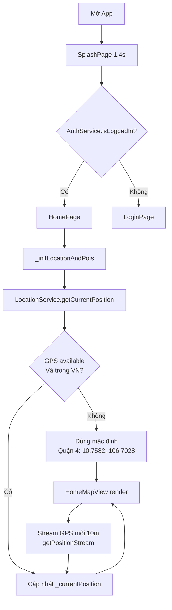

### File Code Liên Quan

| File                                                                                                  | Vai trò                                      |
| ----------------------------------------------------------------------------------------------------- | -------------------------------------------- |
| [`splash_page.dart`](file:///d:/Seminar/seminar_mobile/lib/presentation/pages/splash_page.dart)       | Redirect sau 1.4s                            |
| [`home_page.dart`](file:///d:/Seminar/seminar_mobile/lib/presentation/pages/home_page.dart)           | Orchestrator chính, `_initLocationAndPois()` |
| [`location_service.dart`](file:///d:/Seminar/seminar_mobile/lib/core/services/location_service.dart)  | GPS permission, lấy vị trí, stream           |
| [`home_map_view.dart`](file:///d:/Seminar/seminar_mobile/lib/presentation/widgets/home_map_view.dart) | Widget bản đồ flutter_map                    |
| [`map_controller.dart`](file:///d:/Seminar/seminar_mobile/lib/features/map/map_controller.dart)       | Điều khiển camera bản đồ, bounds Quận 4      |

---

## US1.2 — Xem Marker Địa điểm (POI) trên Bản đồ

> _"Là khách tham quan, tôi muốn thấy các địa điểm được đánh dấu trên bản đồ để biết xung quanh tôi có những điểm nào."_

### Tính năng cần có

- [x] API lấy danh sách POI theo lat/lng (pagination)
- [x] Hiển thị marker trên bản đồ cho từng POI
- [x] Gửi `Accept-Language` header để backend trả đúng ngôn ngữ
- [x] Fallback: danh sách rỗng nếu API lỗi (không crash)

### Luồng hoạt động

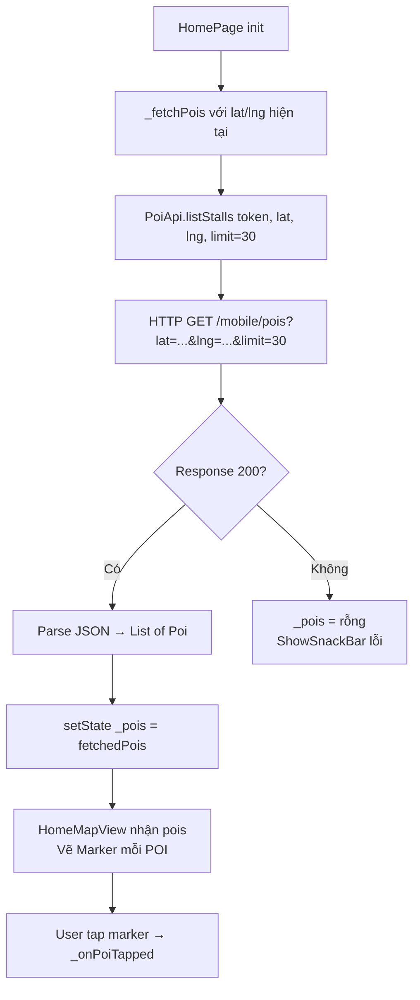

### File Code Liên Quan

| File                                                                                                  | Vai trò                                               |
| ----------------------------------------------------------------------------------------------------- | ----------------------------------------------------- |
| [`home_page.dart`](file:///d:/Seminar/seminar_mobile/lib/presentation/pages/home_page.dart#L130-L173) | `_fetchPois()` gọi API                                |
| [`poi_api.dart`](file:///d:/Seminar/seminar_mobile/lib/data/remote/poi_api.dart#L22-L119)             | `listPois()` — HTTP client với candidate URL fallback |
| [`http_client.dart`](file:///d:/Seminar/seminar_mobile/lib/data/remote/http_client.dart)              | Auto-refresh token khi 401                            |
| [`poi.dart`](file:///d:/Seminar/seminar_mobile/lib/data/models/poi.dart)                              | Model `Poi.fromJson()` — parse flexible JSON          |
| [`home_map_view.dart`](file:///d:/Seminar/seminar_mobile/lib/presentation/widgets/home_map_view.dart) | Render marker list                                    |

> [!NOTE] `PoiApi.listPois` thử lần lượt 6 candidate URL (`/mobile/pois`, `/mobile/stalls`, `/api/v1/...`) để tương thích backend cũ/mới. Header `Accept-Language` gửi ngôn ngữ hiện tại để backend trả nội dung đúng locale.

---

## US1.3 — Tìm kiếm Địa điểm & Chế độ Danh sách

> _"Là khách tham quan, tôi muốn chuyển sang List View và tìm kiếm địa điểm theo tên để tìm nhanh."_

### Tính năng cần có

- [x] Toggle Map View ↔ List View (button AppBar)
- [x] Thanh tìm kiếm floating với autocomplete suggestions
- [x] Debounce 500ms để tránh spam API
- [x] Clear search → fetch lại toàn bộ POI
- [x] Hiển thị khoảng cách từ user đến mỗi POI

### Luồng hoạt động

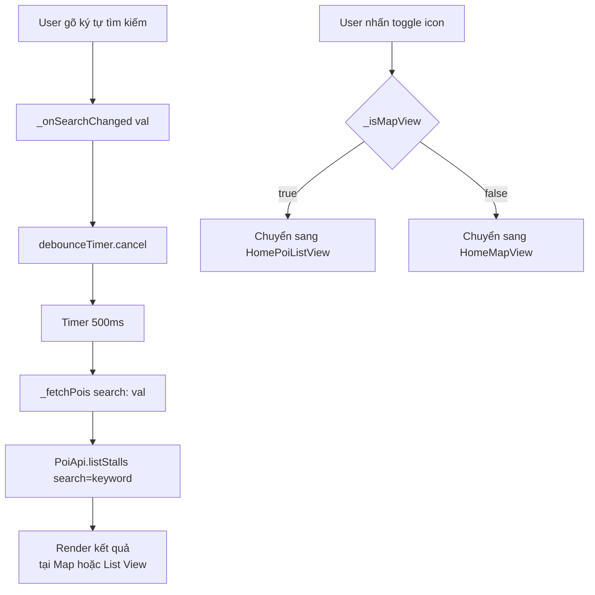

### File Code Liên Quan

| File                                                                                                            | Vai trò                                                     |
| --------------------------------------------------------------------------------------------------------------- | ----------------------------------------------------------- |
| [`home_page.dart`](file:///d:/Seminar/seminar_mobile/lib/presentation/pages/home_page.dart#L176-L194)           | `_onSearchChanged()`, `_clearSearch()`, toggle `_isMapView` |
| [`home_search_bar.dart`](file:///d:/Seminar/seminar_mobile/lib/presentation/widgets/home_search_bar.dart)       | UI thanh tìm kiếm + dropdown suggestions                    |
| [`home_poi_list_view.dart`](file:///d:/Seminar/seminar_mobile/lib/presentation/widgets/home_poi_list_view.dart) | List view hiển thị POI + khoảng cách                        |
| [`poi_card_item.dart`](file:///d:/Seminar/seminar_mobile/lib/presentation/widgets/poi_card_item.dart)           | Card 1 POI trong list                                       |
| [`debounce.dart`](file:///d:/Seminar/seminar_mobile/lib/core/utils/debounce.dart)                               | Utility debounce                                            |

---

## US1.4 — Xem Chi tiết Địa điểm

> _"Là khách tham quan, tôi muốn bấm vào một địa điểm để xem thông tin chi tiết (hình ảnh, mô tả, khoảng cách)."_

### Tính năng cần có

- [x] Ảnh cover fullscreen (SliverAppBar)
- [x] Rating, category chip
- [x] Thông tin: giờ mở cửa, số điện thoại, khoảng giá, website, chủ quán
- [x] Khoảng cách tính theo GPS hiện tại
- [x] Nút "Phát Thuyết Minh" / "Chỉ đường"
- [x] Danh sách bài thuyết minh (nội dung được dịch sang ngôn ngữ user)
- [ ] Nút Yêu thích (UI có, chưa persist)

### Luồng hoạt động

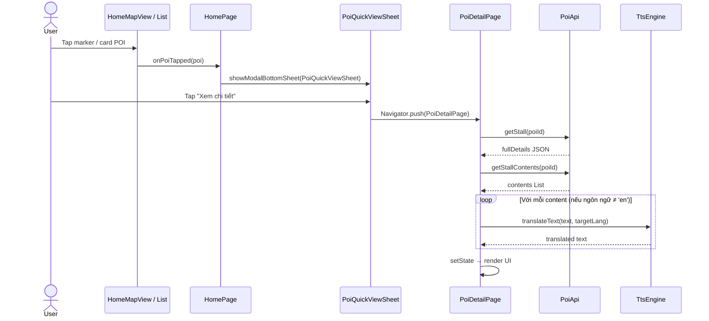

### File Code Liên Quan

| File                                                                                                                | Vai trò                                           |
| ------------------------------------------------------------------------------------------------------------------- | ------------------------------------------------- |
| [`poi_detail_page.dart`](file:///d:/Seminar/seminar_mobile/lib/presentation/pages/poi_detail_page.dart)             | Toàn bộ màn hình chi tiết                         |
| [`poi_quick_view_sheet.dart`](file:///d:/Seminar/seminar_mobile/lib/presentation/widgets/poi_quick_view_sheet.dart) | BottomSheet preview trước khi vào detail          |
| [`poi_api.dart`](file:///d:/Seminar/seminar_mobile/lib/data/remote/poi_api.dart#L322-L375)                          | `getPoi()`, `getPoiContents()`                    |
| [`tts_engine.dart`](file:///d:/Seminar/seminar_mobile/lib/engines/tts_engine.dart#L109-L154)                        | `translateText()` — Google Translate free API     |
| [`location_service.dart`](file:///d:/Seminar/seminar_mobile/lib/core/services/location_service.dart#L86-L108)       | `calculateDistanceInMeters()`, `formatDistance()` |

---

## US1.5 — Tap Điểm Bất Kỳ trên Bản đồ → Phát Thuyết Minh Lân Cận

> _"Là khách tham quan, khi tôi chạm vào bất kỳ điểm nào trên bản đồ, tôi muốn nghe ngay thuyết minh của các địa điểm gần đó."_

### Tính năng cần có

- [x] Đặt marker tại điểm vừa tap
- [x] API lấy nội dung lân cận (bán kính 30m)
- [x] Hiển thị BottomSheet danh sách bài thuyết minh
- [x] Tự động phát chuỗi bài liên tiếp (playlist)

### Luồng hoạt động

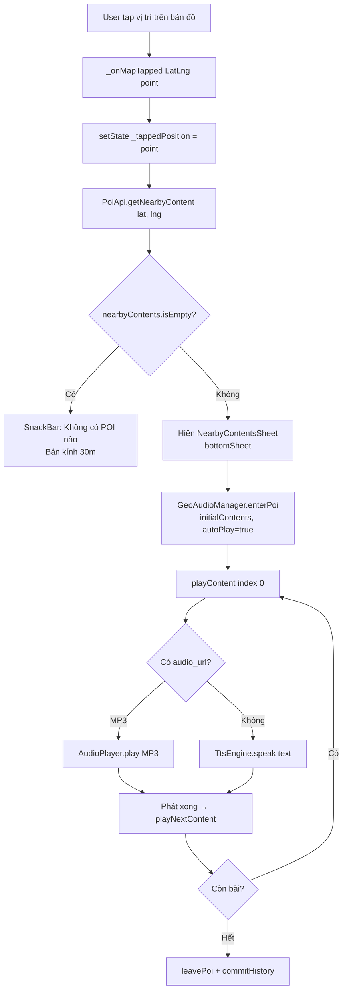

### File Code Liên Quan

| File                                                                                                                  | Vai trò                                                  |
| --------------------------------------------------------------------------------------------------------------------- | -------------------------------------------------------- |
| [`home_page.dart`](file:///d:/Seminar/seminar_mobile/lib/presentation/pages/home_page.dart#L284-L366)                 | `_onMapTapped()` orchestrator                            |
| [`poi_api.dart`](file:///d:/Seminar/seminar_mobile/lib/data/remote/poi_api.dart#L248-L313)                            | `getNearbyContent()` — endpoint `/mobile/content/nearby` |
| [`nearby_contents_sheet.dart`](file:///d:/Seminar/seminar_mobile/lib/presentation/widgets/nearby_contents_sheet.dart) | BottomSheet playlist                                     |
| [`geo_audio_manager.dart`](file:///d:/Seminar/seminar_mobile/lib/core/services/geo_audio_manager.dart)                | `enterPoi()`, `playContent()`, `playNextContent()`       |

---

# 🎧 EPIC 2 — Trải nghiệm Thuyết minh Audio

---

## US2.1 — Phát Thuyết Minh tại Trang Chi tiết POI

> _"Là người dùng, tôi muốn bấm 'Phát' để nghe thuyết minh thay vì đọc văn bản dài."_

### Tính năng cần có

- [x] Nút "Phát Thuyết Minh" nổi bật
- [x] Ưu tiên phát file MP3 từ backend (`audio_url`)
- [x] Fallback TTS đọc text nếu không có MP3
- [x] Dịch text sang ngôn ngữ người dùng trước khi TTS
- [x] Full audio player (slider, play/pause, seek ±10s)
- [x] Loading state khi đang tải nội dung

### Luồng hoạt động

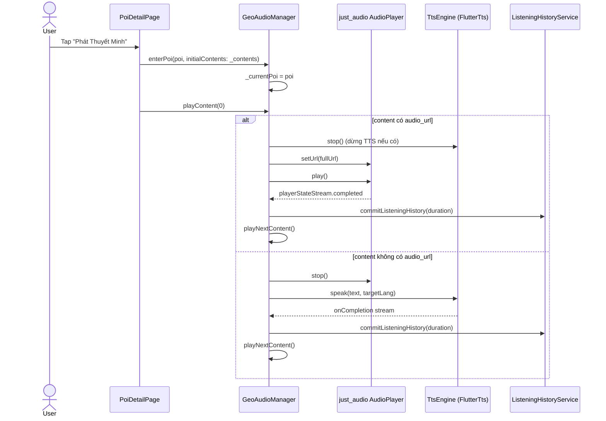

### Tính năng kỹ thuật chi tiết

| Kỹ thuật           | Mô tả                                            | File                                                                                                                        |
| ------------------ | ------------------------------------------------ | --------------------------------------------------------------------------------------------------------------------------- |
| **Priority MP3**   | Nếu `audio_url` tồn tại → `AudioPlayer.setUrl()` | [`geo_audio_manager.dart#L159-L185`](file:///d:/Seminar/seminar_mobile/lib/core/services/geo_audio_manager.dart#L159-L185)  |
| **TTS Fallback**   | Không có MP3 → `TtsEngine.speak()`               | [`geo_audio_manager.dart#L187-L204`](file:///d:/Seminar/seminar_mobile/lib/core/services/geo_audio_manager.dart#L187-L204)  |
| **Auto-translate** | `TtsEngine.translateText()` → Google free API    | [`tts_engine.dart#L109-L154`](file:///d:/Seminar/seminar_mobile/lib/engines/tts_engine.dart#L109-L154)                      |
| **History commit** | Mỗi bài phát xong → ghi lịch sử lên backend      | [`geo_audio_manager.dart#L104-L138`](file:///d:/Seminar/seminar_mobile/lib/core/services/geo_audio_manager.dart#L104-L138)  |
| **Full player UI** | Slider progress, replay/forward 10s              | [`poi_detail_page.dart#L498-L633`](file:///d:/Seminar/seminar_mobile/lib/presentation/pages/poi_detail_page.dart#L498-L633) |

---

## US2.2 — Mini Player Nổi khi Quay lại Bản đồ

> _"Là người dùng, tôi muốn có Mini Player hiển thị thu nhỏ khi quay về màn hình chính để vừa nghe vừa xem bản đồ."_

### Tính năng cần có

- [x] Mini Player tự hiện khi `GeoAudioManager.currentPoi != null`
- [x] Tự ẩn khi không có bài đang phát
- [x] Thanh progress bar mỏng (LinearProgressIndicator)
- [x] Nút Play/Pause trực tiếp trên Mini Player
- [x] Nút đóng (leavePoi)
- [x] Tap → mở PoiDetailPage đầy đủ
- [x] Hiển thị ở MỌI màn hình (Home, History, Profile)

### Luồng hoạt động

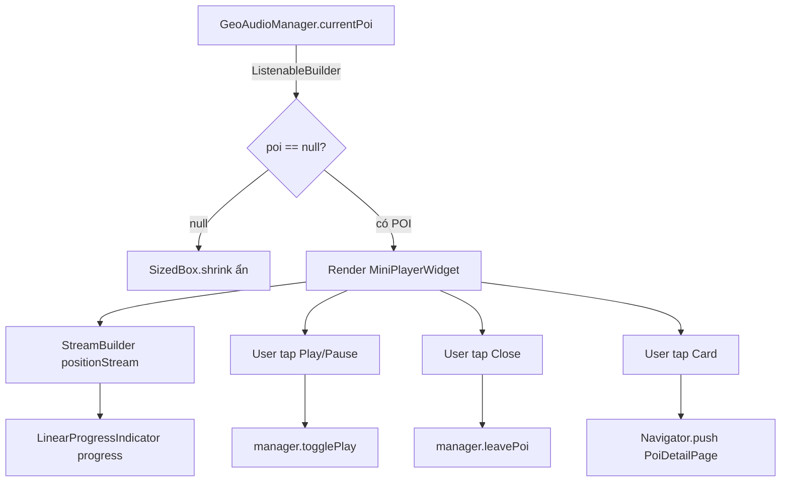

### File Code Liên Quan

| File                                                                                                                            | Vai trò                                                          |
| ------------------------------------------------------------------------------------------------------------------------------- | ---------------------------------------------------------------- |
| [`mini_player_widget.dart`](file:///d:/Seminar/seminar_mobile/lib/presentation/widgets/mini_player_widget.dart)                 | Toàn bộ UI mini player, dùng `ListenableBuilder`                 |
| [`geo_audio_manager.dart`](file:///d:/Seminar/seminar_mobile/lib/core/services/geo_audio_manager.dart#L293-L298)                | `positionStream`, `durationStream`, `togglePlay()`, `leavePoi()` |
| [`home_page.dart`](file:///d:/Seminar/seminar_mobile/lib/presentation/pages/home_page.dart#L482-L492)                           | Đặt MiniPlayer trong `bottomNavigationBar`                       |
| [`listening_history_page.dart`](file:///d:/Seminar/seminar_mobile/lib/presentation/pages/listening_history_page.dart#L366-L376) | MiniPlayer cũng hiện ở trang History                             |
| [`profile_page.dart`](file:///d:/Seminar/seminar_mobile/lib/presentation/pages/profile_page.dart#L234-L246)                     | MiniPlayer cũng hiện ở trang Profile                             |

> [!TIP] `ListenableBuilder` lắng nghe `GeoAudioManager` (ChangeNotifier). Mỗi khi `notifyListeners()` được gọi (play/pause/stop/switch track), toàn bộ MiniPlayer rebuild tự động mà không cần setState.

---

## US2.3 — Điều Khiển Audio (Seek, Tua, Tạm dừng)

> _"Là người dùng, tôi muốn tua nhanh, tua lại, tạm dừng và xem tiến trình bài đang phát."_

### Tính năng cần có

- [x] Slider tua theo thời gian (StreamBuilder từ just_audio)
- [x] Hiển thị `mm:ss / mm:ss` (vị trí / tổng thời lượng)
- [x] Nút ⏮ 10 giây (seekBackward)
- [x] Nút ▶/⏸ Play/Pause (togglePlay)
- [x] Nút ⏭ 10 giây (seekForward)
- [x] Clamp seek: không vượt quá duration, không dưới 0

### Luồng hoạt động

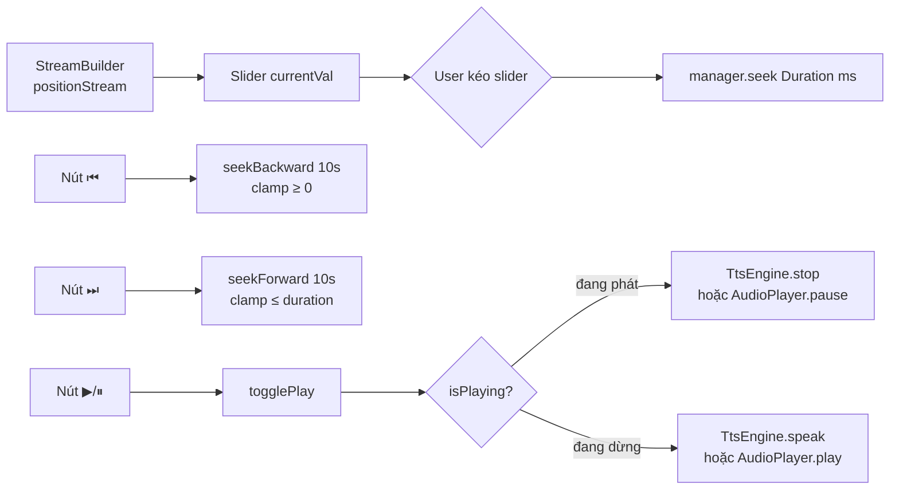

### File Code Liên Quan

| File                                                                                                              | Vai trò                                                     |
| ----------------------------------------------------------------------------------------------------------------- | ----------------------------------------------------------- |
| [`poi_detail_page.dart`](file:///d:/Seminar/seminar_mobile/lib/presentation/pages/poi_detail_page.dart#L537-L626) | `_buildFullAudioPlayer()` — slider + controls               |
| [`geo_audio_manager.dart`](file:///d:/Seminar/seminar_mobile/lib/core/services/geo_audio_manager.dart#L300-L318)  | `seek()`, `seekForward()`, `seekBackward()`, `togglePlay()` |

> [!NOTE] Khi ngôn ngữ là `'en'`, player dùng `AudioPlayer.pause()/play()` (just_audio). Các ngôn ngữ khác dùng `TtsEngine.stop()/speak()` vì FlutterTTS không hỗ trợ pause/resume đúng nghĩa.

---

## US2.4 — Đa ngôn ngữ Thuyết minh (5 ngôn ngữ)

> _"Là một du khách nước ngoài, tôi muốn nghe thuyết minh bằng ngôn ngữ của tôi (EN/JA/KO/ZH)."_

### Tính năng cần có

- [x] Chọn ngôn ngữ trên trang Profile (LanguageSelector)
- [x] Tự động dịch nội dung sang ngôn ngữ chọn (Google Translate API)
- [x] TTS đọc đúng ngôn ngữ (map locale code → TTS locale tag)
- [x] Gửi `Accept-Language` header lên backend để nhận nội dung đúng
- [x] Lưu ngôn ngữ vào SharedPreferences (giữ sau khi restart app)

### Ánh xạ ngôn ngữ

| Ngôn ngữ   | Locale Code | TTS Locale | Google Translate |
| ---------- | ----------- | ---------- | ---------------- |
| Tiếng Việt | `vi`        | `vi-VN`    | `vi`             |
| English    | `en`        | `en-US`    | `en`             |
| 日本語     | `ja`        | `ja-JP`    | `ja`             |
| 한국어     | `ko`        | `ko-KR`    | `ko`             |
| 中文       | `zh`        | `zh-CN`    | `zh-CN`          |

### File Code Liên Quan

| File                                                                                                          | Vai trò                                        |
| ------------------------------------------------------------------------------------------------------------- | ---------------------------------------------- |
| [`locale_provider.dart`](file:///d:/Seminar/seminar_mobile/lib/core/services/locale_provider.dart)            | Singleton, lưu/đọc locale từ SharedPreferences |
| [`language_selector.dart`](file:///d:/Seminar/seminar_mobile/lib/presentation/widgets/language_selector.dart) | Dropdown chọn ngôn ngữ                         |
| [`tts_engine.dart`](file:///d:/Seminar/seminar_mobile/lib/engines/tts_engine.dart#L47-L106)                   | `_mapTtsLocale()`, `_mapTranslateCode()`       |
| [`poi_api.dart`](file:///d:/Seminar/seminar_mobile/lib/data/remote/poi_api.dart#L62-L70)                      | Header `Accept-Language` cho mỗi request       |
| [`l10n/`](file:///d:/Seminar/seminar_mobile/lib/l10n/)                                                        | 5 file localization (vi, en, ja, ko, zh)       |

---

# 👤 EPIC 3 — Tài khoản & Cá nhân hoá

---

## US3.1 — Đăng ký & Xác thực OTP

> _"Là người dùng mới, tôi muốn đăng ký tài khoản bằng email và xác nhận qua OTP để bắt đầu dùng ứng dụng."_

### Tính năng cần có

- [x] Form đăng ký (tên, email, mật khẩu)
- [x] Backend gửi OTP về email
- [x] Màn hình nhập OTP xác thực
- [x] Sau verify → tự động đăng nhập (nhận token)
- [x] Lưu accessToken + refreshToken vào SharedPreferences

### Luồng hoạt động

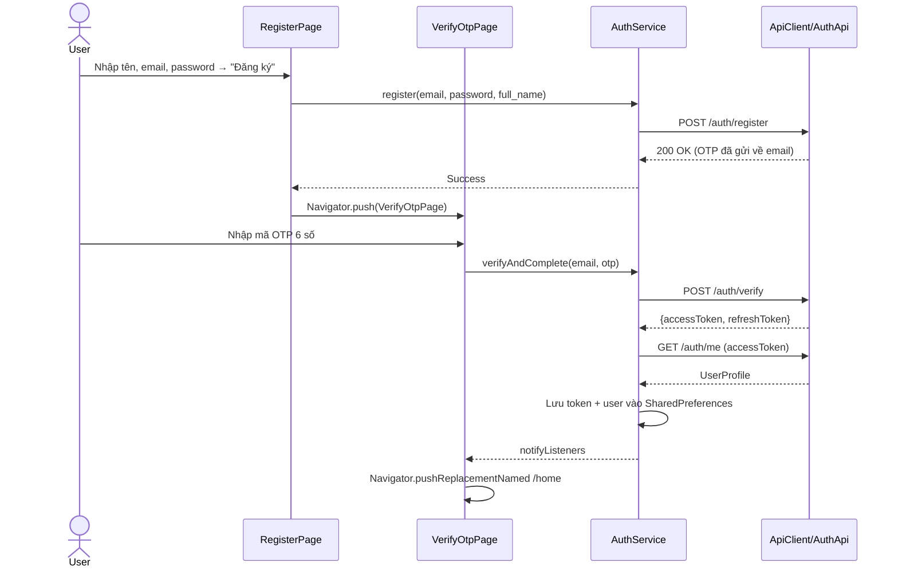

### File Code Liên Quan

| File                                                                                                    | Vai trò                             |
| ------------------------------------------------------------------------------------------------------- | ----------------------------------- |
| [`register_page.dart`](file:///d:/Seminar/seminar_mobile/lib/presentation/pages/register_page.dart)     | Form đăng ký                        |
| [`verify_otp_page.dart`](file:///d:/Seminar/seminar_mobile/lib/presentation/pages/verify_otp_page.dart) | Nhập OTP                            |
| [`auth_service.dart`](file:///d:/Seminar/seminar_mobile/lib/core/services/auth_service.dart#L208-L254)  | `register()`, `verifyAndComplete()` |
| [`auth_api.dart`](file:///d:/Seminar/seminar_mobile/lib/data/remote/auth_api.dart)                      | HTTP POST đến backend               |

---

## US3.2 — Đăng nhập (Email / Google / Device)

> _"Là người dùng có tài khoản, tôi muốn đăng nhập bằng email/mật khẩu hoặc Google để truy cập nội dung cá nhân."_

### Tính năng cần có

- [x] Đăng nhập email + password
- [x] Đăng nhập Google OAuth (Google Sign In)
- [x] Đăng nhập thiết bị (Device ID — không cần tài khoản)
- [x] Auto refresh token khi hết hạn (interceptor HTTP 401)
- [x] Giữ đăng nhập sau restart (SharedPreferences)

### Luồng hoạt động

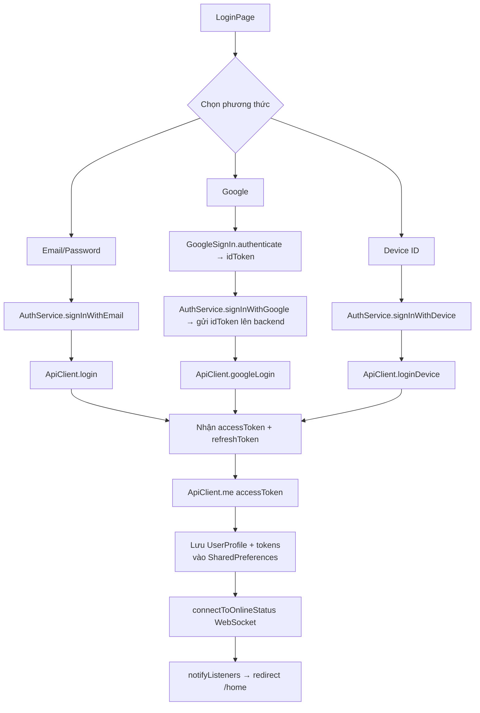

### File Code Liên Quan

| File                                                                                                           | Vai trò                                                         |
| -------------------------------------------------------------------------------------------------------------- | --------------------------------------------------------------- |
| [`login_page.dart`](file:///d:/Seminar/seminar_mobile/lib/presentation/pages/login_page.dart)                  | UI 3 phương thức đăng nhập                                      |
| [`auth_service.dart`](file:///d:/Seminar/seminar_mobile/lib/core/services/auth_service.dart#L341-L514)         | `signInWithEmail()`, `signInWithGoogle()`, `signInWithDevice()` |
| [`http_client.dart`](file:///d:/Seminar/seminar_mobile/lib/data/remote/http_client.dart)                       | Auto-refresh token interceptor khi nhận HTTP 401                |
| [`online_status_service.dart`](file:///d:/Seminar/seminar_mobile/lib/core/services/online_status_service.dart) | Kết nối WebSocket sau đăng nhập                                 |

---

## US3.3 — Quản lý Hồ sơ Cá nhân

> _"Là người dùng đã đăng nhập, tôi muốn xem và cập nhật thông tin cá nhân, đổi mật khẩu, chọn ngôn ngữ."_

### Tính năng cần có

- [x] Hiển thị avatar, tên, email từ API
- [x] Chỉnh sửa tên / email / số điện thoại
- [x] Đổi mật khẩu (yêu cầu mật khẩu cũ)
- [x] Chọn ngôn ngữ ứng dụng (LanguageSelector)
- [x] Đăng xuất (clear token + WebSocket disconnect)
- [ ] Switch AutoPlay (UI có, chưa implement logic)
- [ ] Switch Notifications (UI có, chưa implement logic)

### File Code Liên Quan

| File                                                                                                              | Vai trò                                               |
| ----------------------------------------------------------------------------------------------------------------- | ----------------------------------------------------- |
| [`profile_page.dart`](file:///d:/Seminar/seminar_mobile/lib/presentation/pages/profile_page.dart)                 | Màn hình Profile + Settings                           |
| [`update_profile_page.dart`](file:///d:/Seminar/seminar_mobile/lib/presentation/pages/update_profile_page.dart)   | Form cập nhật thông tin                               |
| [`change_password_page.dart`](file:///d:/Seminar/seminar_mobile/lib/presentation/pages/change_password_page.dart) | Form đổi mật khẩu                                     |
| [`auth_service.dart`](file:///d:/Seminar/seminar_mobile/lib/core/services/auth_service.dart#L516-L528)            | `signOut()` — clear SharedPreferences + disconnect WS |

---

## US3.4 — Xem Lịch sử Nghe Thuyết minh

> _"Là người dùng, tôi muốn xem lại lịch sử nghe để biết mình đã nghe những bài nào và nghe lại dễ dàng."_

### Tính năng cần có

- [x] Danh sách bài đã nghe (tên POI, tên bài, thời gian nghe, thời lượng)
- [x] Thumbnail ảnh cover POI
- [x] Pagination (page 1, size 30)
- [x] Pull-to-refresh
- [x] Tap item → mở PoiDetailPage để nghe lại
- [x] Trạng thái trống / lỗi có UI riêng

### Luồng hoạt động

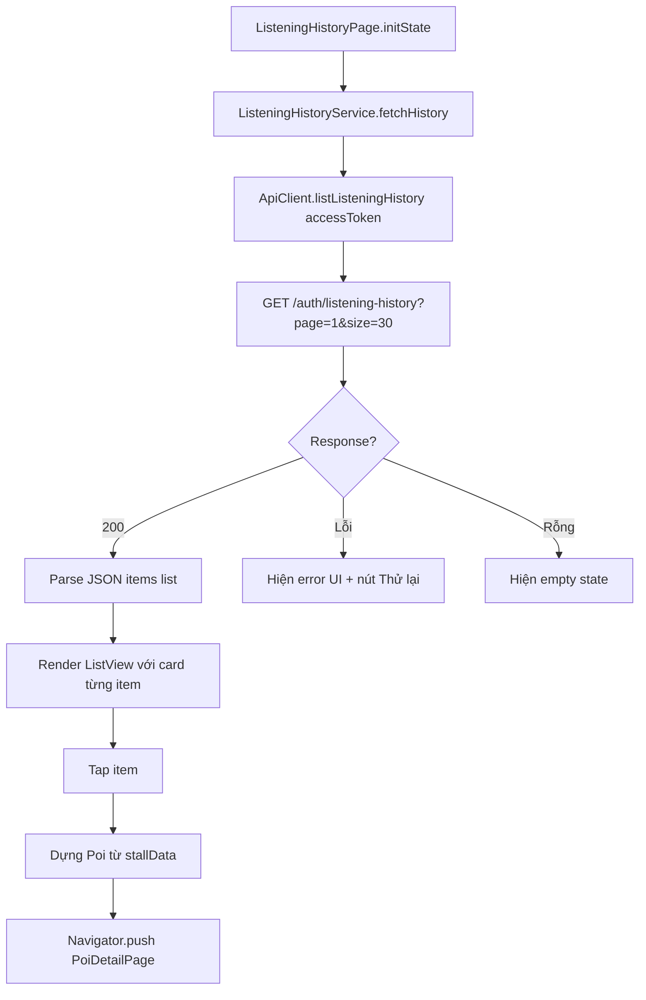

### Luồng ghi lịch sử (auto-commit)

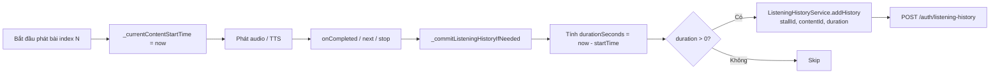

### File Code Liên Quan

| File                                                                                                                   | Vai trò                                           |
| ---------------------------------------------------------------------------------------------------------------------- | ------------------------------------------------- |
| [`listening_history_page.dart`](file:///d:/Seminar/seminar_mobile/lib/presentation/pages/listening_history_page.dart)  | Toàn bộ UI trang lịch sử                          |
| [`listening_history_service.dart`](file:///d:/Seminar/seminar_mobile/lib/core/services/listening_history_service.dart) | `fetchHistory()`, `addHistory()`                  |
| [`geo_audio_manager.dart`](file:///d:/Seminar/seminar_mobile/lib/core/services/geo_audio_manager.dart#L104-L138)       | `_commitListeningHistoryIfNeeded()` — auto-commit |
| [`auth_api.dart`](file:///d:/Seminar/seminar_mobile/lib/data/remote/auth_api.dart)                                     | `listListeningHistory()`, `addListeningHistory()` |

---

## US3.5 — Trạng thái Online Realtime (WebSocket)

> _"Là admin hệ thống, tôi muốn theo dõi số người đang dùng app theo thời gian thực."_

### Tính năng cần có

- [x] Kết nối WebSocket ngay khi khởi động app (trước cả đăng nhập)
- [x] Ping/Pong heartbeat mỗi 30 giây
- [x] Auto-reconnect sau 5 giây khi mất kết nối
- [x] Nhận `online_count` từ server
- [x] Gửi `device_id` + `user_id` (hoặc null nếu chưa đăng nhập)
- [x] Quản lý lifecycle: resume app → đảm bảo WebSocket connected

### Luồng hoạt động

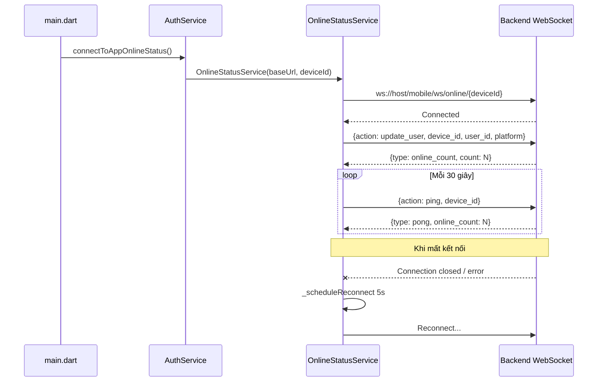

### File Code Liên Quan

| File                                                                                                           | Vai trò                                                  |
| -------------------------------------------------------------------------------------------------------------- | -------------------------------------------------------- |
| [`online_status_service.dart`](file:///d:/Seminar/seminar_mobile/lib/core/services/online_status_service.dart) | Toàn bộ WebSocket logic                                  |
| [`auth_service.dart`](file:///d:/Seminar/seminar_mobile/lib/core/services/auth_service.dart#L148-L204)         | `connectToAppOnlineStatus()`, `_connectToOnlineStatus()` |
| [`main.dart`](file:///d:/Seminar/seminar_mobile/lib/main.dart#L73-L104)                                        | `didChangeAppLifecycleState` — đảm bảo WS khi resume     |

---

# 🗂️ Tổng hợp Ma trận User Story ↔ File Code

| User Story         | Pages                                               | Widgets                                 | Services                                         | Engines      | API                               |
| ------------------ | --------------------------------------------------- | --------------------------------------- | ------------------------------------------------ | ------------ | --------------------------------- |
| US1.1 Bản đồ       | `home_page`                                         | `home_map_view`                         | `location_service`                               | —            | —                                 |
| US1.2 POI Marker   | `home_page`                                         | `home_map_view`                         | —                                                | —            | `poi_api.listPois`                |
| US1.3 Tìm kiếm     | `home_page`                                         | `home_search_bar`, `home_poi_list_view` | —                                                | —            | `poi_api.listPois`                |
| US1.4 Chi tiết POI | `poi_detail_page`                                   | `poi_quick_view_sheet`                  | `location_service`                               | `tts_engine` | `poi_api.getPoi/getContents`      |
| US1.5 Tap Bản đồ   | `home_page`                                         | `nearby_contents_sheet`                 | `geo_audio_manager`                              | —            | `poi_api.getNearbyContent`        |
| US2.1 Phát Audio   | `poi_detail_page`                                   | —                                       | `geo_audio_manager`                              | `tts_engine` | —                                 |
| US2.2 Mini Player  | —                                                   | `mini_player_widget`                    | `geo_audio_manager`                              | —            | —                                 |
| US2.3 Điều khiển   | `poi_detail_page`                                   | —                                       | `geo_audio_manager`                              | —            | —                                 |
| US2.4 Đa ngôn ngữ  | `profile_page`                                      | `language_selector`                     | `locale_provider`                                | `tts_engine` | header `Accept-Language`          |
| US3.1 Đăng ký OTP  | `register_page`, `verify_otp_page`                  | —                                       | `auth_service`                                   | —            | `auth_api.register/verify`        |
| US3.2 Đăng nhập    | `login_page`                                        | —                                       | `auth_service`                                   | —            | `auth_api.login/google/device`    |
| US3.3 Hồ sơ        | `profile_page`, `update_profile`, `change_password` | `language_selector`                     | `auth_service`                                   | —            | `auth_api.me/updateProfile`       |
| US3.4 Lịch sử      | `listening_history_page`                            | —                                       | `listening_history_service`, `geo_audio_manager` | —            | `auth_api.listHistory/addHistory` |
| US3.5 Online WS    | —                                                   | —                                       | `auth_service`, `online_status_service`          | —            | WebSocket                         |

---

> [!IMPORTANT] Các tính năng **chưa hoàn thiện** (cần phát triển thêm):
>
> - `geofence_engine.dart` — tự động trigger thuyết minh khi user đi vào vùng POI (file rỗng)
> - `narration_engine.dart` — orchestrator cho chuỗi thuyết minh phức tạp hơn (file rỗng)
> - `audio_queue_manager.dart` — quản lý queue đa track (file rỗng)
> - Nút **Yêu thích** POI — UI có nhưng chưa persist vào backend
> - Switch **AutoPlay / Notifications** — UI có nhưng chưa có logic thực
> - Tính năng **Chỉ đường** — hiện chỉ show SnackBar placeholder
