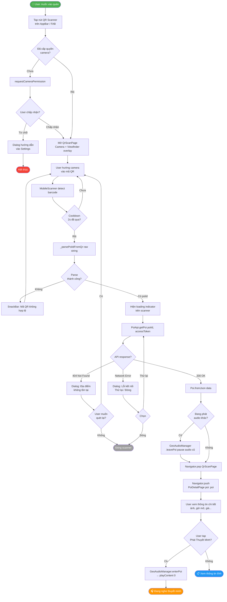
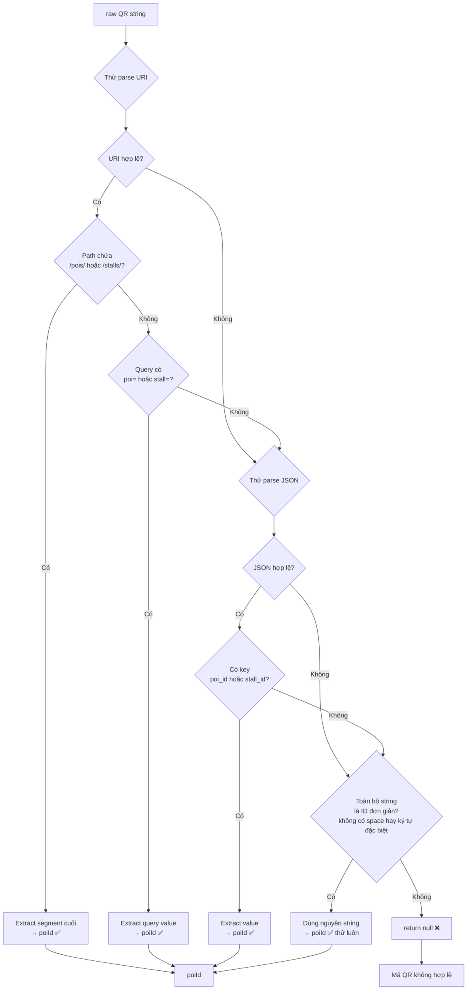

# US-QR — Quét Mã QR Hiển thị Chi tiết Quán

> **User Story:**  
> _"Là một khách tham quan, tôi muốn quét mã QR tại một địa điểm để xem ngay thông tin chi tiết và nghe thuyết minh — mà không cần tìm kiếm hay tap bản đồ."_

---

## 📊 Phân tích Hiện trạng

| Hạng mục                            | Trạng thái                    | Ghi chú                    |
| ----------------------------------- | ----------------------------- | -------------------------- |
| Package `mobile_scanner ^7.4.2`     | ✅ Đã khai báo `pubspec.yaml` | Chưa được dùng             |
| File `QrScanPage` hoặc tương tự     | ❌ Chưa tồn tại               | Cần tạo mới                |
| API `getPoi(poiId)`                 | ✅ Có sẵn                     | `PoiApi.instance.getPoi()` |
| `PoiDetailPage` nhận `Poi` object   | ✅ Có sẵn                     | Điểm đến sau quét QR       |
| Nút mở QR scanner từ màn hình chính | ❌ Chưa có                    | Cần thêm vào AppBar/FAB    |
| Xử lý QR format (URL / ID thuần)    | ❌ Chưa có                    | Cần implement parser       |
| Cooldown chống quét lặp lại         | ❌ Chưa có                    | `cooldown.dart` có sẵn     |

> [!IMPORTANT] `mobile_scanner` đã được cài sẵn — **không cần thêm package**. Chỉ cần implement code.

---

## 🚦 Đề xuất 5 Bước Cải tiến

### Bước 1 — Tạo `QrScanPage` (màn hình camera quét QR)

Tạo file `lib/presentation/pages/qr_scan_page.dart`:

- Dùng `MobileScanner` widget làm camera preview
- Overlay viewfinder hình vuông chính giữa
- Nút đèn pin (torch) toggle
- Nút đóng scanner
- Throttle: cooldown 2s sau mỗi lần quét thành công (dùng `cooldown.dart`)

---

### Bước 2 — Implement QR Code Parser (`_parsePoiIdFromQr`)

QR có thể chứa nhiều định dạng:

| Định dạng QR  | Ví dụ                                               | Cách xử lý                |
| ------------- | --------------------------------------------------- | ------------------------- |
| URL đầy đủ    | `https://app.com/pois/abc123`                       | Extract path segment cuối |
| URL API       | `http://192.168.1.8:8000/api/v1/mobile/pois/abc123` | Extract ID                |
| ID thuần      | `abc123`                                            | Dùng trực tiếp            |
| JSON          | `{"poi_id":"abc123"}`                               | Parse JSON                |
| URL với query | `https://app.com/?poi=abc123`                       | Extract query param       |

```
Input QR raw string
  → thử parse URI
    → path có dạng /pois/{id} hoặc /stalls/{id} → extract ID
    → query có key poi hoặc stall → extract value
  → thử parse JSON
    → key poi_id hoặc stall_id → extract value
  → fallback: dùng toàn bộ string làm ID (nếu không có space/khoảng trắng)
  → không nhận dạng được → show error
```

---

### Bước 3 — Gọi API `getPoi(poiId)` → Dựng `Poi` object

Sau khi có `poiId`, reuse API đã sẵn có:

```
PoiApi.instance.getPoi(poiId, accessToken)
  → Poi.fromJson(data)
  → Navigator.push(PoiDetailPage(poi: poi))
```

---

### Bước 4 — Thêm Nút Mở QR Scanner vào UI

Vị trí đề xuất:

- **AppBar của `HomePage`** — icon `qr_code_scanner` (ưu tiên, dễ thấy)
- **FloatingActionButton** trên bản đồ (phương án thay thế)
- **Tab thứ 4 trong BottomNav** nếu muốn promote tính năng (cần redesign nav)

---

### Bước 5 — Xử lý các Edge Case & UX

| Edge Case                                | Xử lý đề xuất                                                |
| ---------------------------------------- | ------------------------------------------------------------ |
| QR không phải của hệ thống               | Dialog: "Mã QR không hợp lệ. Vui lòng quét mã tại địa điểm." |
| `poiId` không tìm thấy trên server (404) | Dialog: "Địa điểm không tồn tại hoặc đã ngừng hoạt động."    |
| Không có quyền camera                    | Dialog hướng dẫn vào Settings cấp quyền                      |
| Mạng yếu / timeout                       | Retry dialog + loading indicator                             |
| Quét QR trong khi đang phát audio        | Auto-pause audio hiện tại → load POI mới → user chọn play    |
| Quét liên tục (lướt camera)              | Cooldown 2s, chỉ xử lý lần quét đầu tiên                     |

---

## 🎯 Sơ đồ Activity — Luồng Quét QR



---

## 🔄 Sơ đồ Activity — Chi tiết Parse QR



---

## 📂 Các File Cần Tạo / Chỉnh Sửa

### File cần **TẠO MỚI**

| File                                       | Mô tả                                                     |
| ------------------------------------------ | --------------------------------------------------------- |
| `lib/presentation/pages/qr_scan_page.dart` | Màn hình camera quét QR, overlay viewfinder, torch button |

### File cần **CHỈNH SỬA**

| File                                    | Thay đổi                                                                    |
| --------------------------------------- | --------------------------------------------------------------------------- |
| `lib/presentation/pages/home_page.dart` | Thêm `IconButton(Icons.qr_code_scanner)` vào `AppBar.actions`               |
| `lib/main.dart`                         | Thêm route `'/qr_scan': (ctx) => const QrScanPage()`                        |
| `lib/data/remote/poi_api.dart`          | Thêm method `getPoiByQrCode(String rawQr)` (optional — có thể xử lý ở page) |

---

## 💡 Skeleton Code — `QrScanPage`

```dart
// lib/presentation/pages/qr_scan_page.dart

import 'package:flutter/material.dart';
import 'package:mobile_scanner/mobile_scanner.dart';
import '../../core/services/auth_service.dart';
import '../../core/utils/cooldown.dart';
import '../../data/models/poi.dart';
import '../../data/remote/poi_api.dart';
import 'poi_detail_page.dart';

class QrScanPage extends StatefulWidget {
  const QrScanPage({super.key});
  @override
  State<QrScanPage> createState() => _QrScanPageState();
}

class _QrScanPageState extends State<QrScanPage> {
  final MobileScannerController _controller = MobileScannerController();
  final Cooldown _cooldown = Cooldown(duration: const Duration(seconds: 2));
  bool _isProcessing = false;

  @override
  void dispose() {
    _controller.dispose();
    super.dispose();
  }

  /// Parse poiId từ QR raw string
  /// Hỗ trợ: URL, JSON, ID thuần
  String? _parsePoiId(String raw) {
    final trimmed = raw.trim();

    // 1. Thử parse URI
    try {
      final uri = Uri.parse(trimmed);
      final segments = uri.pathSegments;
      for (int i = 0; i < segments.length - 1; i++) {
        if (segments[i] == 'pois' || segments[i] == 'stalls') {
          final id = segments[i + 1];
          if (id.isNotEmpty) return id;
        }
      }
      // Query params
      final poi = uri.queryParameters['poi'] ??
          uri.queryParameters['poi_id'] ??
          uri.queryParameters['stall'] ??
          uri.queryParameters['stall_id'];
      if (poi != null && poi.isNotEmpty) return poi;
    } catch (_) {}

    // 2. Thử parse JSON
    try {
      // ... jsonDecode và extract poi_id / stall_id
    } catch (_) {}

    // 3. Fallback: ID thuần
    if (!trimmed.contains(' ') && trimmed.length > 3) return trimmed;

    return null;
  }

  Future<void> _onDetect(BarcodeCapture capture) async {
    if (_isProcessing || !_cooldown.isReady) return;

    final raw = capture.barcodes.firstOrNull?.rawValue;
    if (raw == null || raw.isEmpty) return;

    _cooldown.trigger();

    final poiId = _parsePoiId(raw);
    if (poiId == null) {
      ScaffoldMessenger.of(context).showSnackBar(
        const SnackBar(content: Text('Mã QR không hợp lệ')),
      );
      return;
    }

    setState(() => _isProcessing = true);
    await _controller.stop();

    try {
      final token = AuthService.instance.accessToken ?? '';
      final data = await PoiApi.instance.getPoi(poiId, token);
      if (data == null) throw Exception('Không tìm thấy địa điểm');

      final poi = Poi.fromJson(data);
      if (!mounted) return;

      Navigator.of(context).pushReplacement(
        MaterialPageRoute(builder: (_) => PoiDetailPage(poi: poi)),
      );
    } catch (e) {
      if (!mounted) return;
      showDialog(
        context: context,
        builder: (_) => AlertDialog(
          title: const Text('Không thể mở địa điểm'),
          content: Text(e.toString()),
          actions: [
            TextButton(
              onPressed: () async {
                Navigator.pop(context);
                await _controller.start();
                setState(() => _isProcessing = false);
              },
              child: const Text('Quét lại'),
            ),
            TextButton(
              onPressed: () => Navigator.pop(context, true),
              child: const Text('Đóng'),
            ),
          ],
        ),
      );
    }
  }

  @override
  Widget build(BuildContext context) {
    return Scaffold(
      backgroundColor: Colors.black,
      appBar: AppBar(
        backgroundColor: Colors.transparent,
        title: const Text('Quét mã QR', style: TextStyle(color: Colors.white)),
        iconTheme: const IconThemeData(color: Colors.white),
        actions: [
          IconButton(
            icon: const Icon(Icons.flashlight_on),
            onPressed: () => _controller.toggleTorch(),
            tooltip: 'Đèn pin',
          ),
        ],
      ),
      body: Stack(
        children: [
          MobileScanner(controller: _controller, onDetect: _onDetect),

          // Viewfinder overlay
          Center(
            child: Container(
              width: 260,
              height: 260,
              decoration: BoxDecoration(
                border: Border.all(color: Colors.orange, width: 3),
                borderRadius: BorderRadius.circular(12),
              ),
            ),
          ),

          // Hướng dẫn
          const Align(
            alignment: Alignment(0, 0.6),
            child: Text(
              'Hướng camera vào mã QR tại địa điểm',
              style: TextStyle(color: Colors.white70, fontSize: 14),
              textAlign: TextAlign.center,
            ),
          ),

          // Loading overlay
          if (_isProcessing)
            Container(
              color: Colors.black54,
              child: const Center(
                child: CircularProgressIndicator(color: Colors.orange),
              ),
            ),
        ],
      ),
    );
  }
}
```

---

## ✅ Checklist Triển khai

```
Phase 1 — Core (MVP)
  □ Tạo QrScanPage với MobileScanner widget
  □ Implement _parsePoiId() đầy đủ 3 format
  □ Gọi PoiApi.getPoi() → navigate PoiDetailPage
  □ Thêm nút QR vào AppBar của HomePage
  □ Đăng ký route /qr_scan trong main.dart
  □ Xử lý quyền camera (Android: CAMERA, iOS: NSCameraUsageDescription)

Phase 2 — UX Polish
  □ Viewfinder animation (line scanning effect)
  □ Haptic feedback khi quét thành công
  □ Torch button hoạt động đúng
  □ Cooldown chống spam quét

Phase 3 — Edge Cases
  □ QR không thuộc hệ thống → error dialog rõ ràng
  □ Offline → retry dialog
  □ Đang phát audio → tự pause trước khi load POI mới
  □ Deep link: app nhận URL scheme qr://poi/{id} từ bên ngoài
```

---

## 🔗 Liên kết Code Hiện Có

| File                                                                                                    | Reuse cho QR                                |
| ------------------------------------------------------------------------------------------------------- | ------------------------------------------- |
| [`poi_api.dart`](file:///d:/Seminar/seminar_mobile/lib/data/remote/poi_api.dart#L322-L375)              | `getPoi(poiId)` — API call sau khi parse QR |
| [`poi_detail_page.dart`](file:///d:/Seminar/seminar_mobile/lib/presentation/pages/poi_detail_page.dart) | Điểm đến cuối cùng                          |
| [`cooldown.dart`](file:///d:/Seminar/seminar_mobile/lib/core/utils/cooldown.dart)                       | Throttle quét liên tục                      |
| [`auth_service.dart`](file:///d:/Seminar/seminar_mobile/lib/core/services/auth_service.dart)            | `accessToken` cho API call                  |
| [`geo_audio_manager.dart`](file:///d:/Seminar/seminar_mobile/lib/core/services/geo_audio_manager.dart)  | `leavePoi()` để dừng audio cũ               |
| [`home_page.dart`](file:///d:/Seminar/seminar_mobile/lib/presentation/pages/home_page.dart)             | Thêm nút QR vào AppBar                      |
